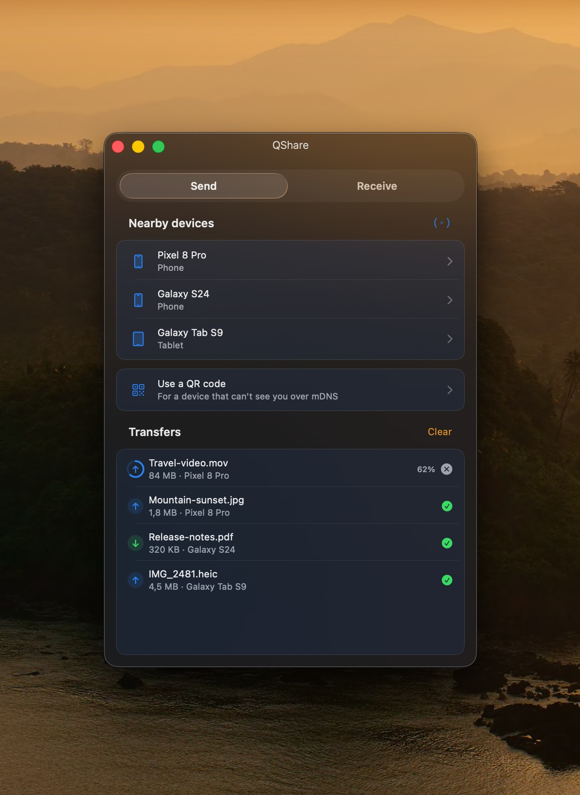
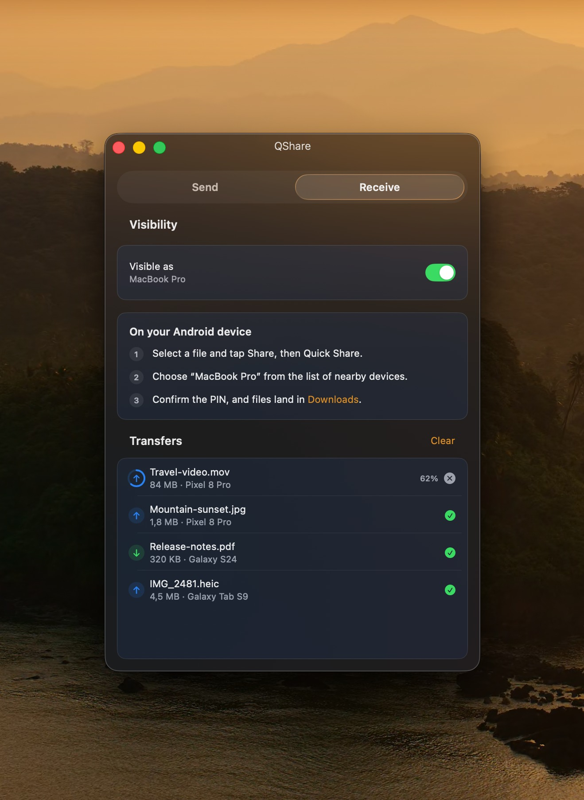

<h1 align="center">KERNPORT</h1>

<p align="center">
  Send a file from a Mac to an Android phone, or the other way,<br>
  on the same Wi-Fi. Pair once. After that, it stays connected.
</p>

<p align="center">
  
  
  
  
</p>

<p align="center">
  
  &nbsp;&nbsp;
  
</p>

---

Your phone already shares with Quick Share. Your Mac shares with AirDrop. Those two do not see each other, so people send the file through a chat app and the photo gets smaller. KERNPORT is the Mac app that speaks Quick Share, so the file stays full size and stays on your Wi-Fi.

Pair the Android phone once. After that it stays connected. You do not pair again for the next file, and you do not pair again for the next copy.

An iPhone does not install anything. The Android phone shows a QR code. Safari opens it. The photo is the original file.

Download the Mac app and the Android app from the [latest release](https://github.com/rian1717/KERNPORT/releases/tag/v0.2.0). That release is still v0.2.0. You do not compile anything. Put the Mac app on the Mac, put the Android file on the phone, and keep both on the same Wi-Fi.

## Features

- **Send** — pick a device and drag files onto it, or drop them on a device row
- **Finder Share extension** — send selected files without opening the main window
- **Receive** — flip visibility on and your Mac appears on the phone
- **Text and links** — saved to your downloads folder as files, never opened
- **PIN verification** — a 4-digit code on both screens before anything moves
- **Explicit consent** — every transfer requires PIN verification and approval
- **QR code** — reach a phone that can't discover you
- **Menu-bar app** — keeps running with the window closed
- **Command-line API** — drive it from scripts or an agent (off by default)
- **Clipboard** — pair once. After that, copy on the Android phone and press ⌘V on the Mac. iPhone copies already paste through Apple Handoff.

## Install

Needs **macOS 26 or later**, an Android phone, and both devices on the same Wi-Fi.

The latest published release is still [v0.2.0](https://github.com/rian1717/KERNPORT/releases/tag/v0.2.0). The product in that release is **KERNPORT**. The two download files are still spelled:

- `Kernport-mac.zip` for the Mac
- `Kernport-android.apk` for the phone

A build from this source is `KERNPORT.app`.

### Mac

1. Unzip `Kernport-mac.zip`.
2. Move **KERNPORT** into **Applications**.
3. Open it. macOS says it cannot check the developer, because this build is not notarized.
4. Control-click **KERNPORT** and choose **Open**, then choose **Open** again.
5. If macOS says the app is damaged, open Terminal and run:

```bash
xattr -dr com.apple.quarantine /Applications/KERNPORT.app
```

The v0.2.0 zip still contains an app file spelled `Kernport.app`. Use that name in the path above if that is the file you moved. Then control-click the app and choose **Open** again. The first launch may ask for Local Network. Allow it.

### Android

1. Copy `Kernport-android.apk` onto the phone and open it.
2. Allow installation from that source if Android asks.
3. If Play Protect blocks it and the only button is **OK**, open the Play Store, tap your profile, open **Play Protect**, tap the gear, and turn off **Improve harmful app detection**. If that switch is missing, turn off **Scan apps with Play Protect**. Install the app, then turn the switch back on.

Open KERNPORT on the Mac and on the phone. The phone shows the Mac. Tap the Mac, then tap **Allow** on the Mac. That pair happens once. After that, the phone stays connected.

## Using it

Both devices stay on the same Wi-Fi. Received files land in `~/Downloads`.
Change that folder in Settings.

**Send to a phone that is already listed.** On the Send tab, drop the file on
that phone. Accept on the phone. The four-digit PIN on both screens should
match.

**Send to a phone that is not listed.** This is the normal path for a Samsung,
and for any phone that does not appear. Tap **Use a QR code**, then drop the
file. The QR code appears on its own. Scan it with the phone's camera or Quick
Share, then accept. There is no second tap to reveal the code.

**Receive from the phone.** Open the Receive tab and turn visibility on. On the
phone, share the file with Quick Share and choose the Mac. Match the PIN and
accept. The phone's Quick Share settings page does not list devices. Start from
the share sheet in Gallery or Files instead.

**Copy on the phone, paste on the Mac.** An iPhone does not use this. iPhone
copies already paste through Apple Handoff when both devices use the same
Apple ID. For Android:

1. On the Mac, open **KERNPORT → Settings…** and turn on **Paste phone copies here**. Leave the QR code and the 8-digit code on screen.
2. Install the Android file from the [latest release](https://github.com/rian1717/KERNPORT/releases/tag/v0.2.0). On v0.2.0 that file is still spelled `Kernport-android.apk`. It is not on the Play Store. If Play Protect says the app is blocked and the only button is **OK**, open the Play Store, tap your profile, open **Play Protect**, tap the gear, and turn off **Improve harmful app detection**. If that switch is missing, turn off **Scan apps with Play Protect**. Install the app, then turn the switch back on.
3. On the phone, scan the Mac's QR code and open it in KERNPORT. Or type the 8-digit code and tap the Mac. Tapping the Mac without the code asks you to tap **Allow** once on the Mac. After that one pair, the phone stays connected.
4. Tap **Turn on clipboard access**. If KERNPORT is marked **Controlled by restricted setting**, open **Settings → Apps → KERNPORT**, tap the three dots, and choose **Allow restricted settings**. Then go back to **Accessibility → Downloaded apps**, tap KERNPORT, and turn it on.
5. Tap **Allow this phone to keep KERNPORT running**. On a Xiaomi phone that is Autostart. On a Samsung phone, keep KERNPORT out of sleeping apps.
6. Copy text, a picture, or a file on the phone, then press **⌘V** on the Mac.

| | |
|---|---|
| `⌘1` / `⌘2` | Send / Receive |
| `⇧⌘V` | Toggle visibility |
| `⇧⌘O` | Open downloads folder |
| `⌃⌥←` / `⌃⌥→` | Snap window to screen edge |
| `⌘⌥I` | Build info |

## If your phone doesn't see your Mac

Usually this isn't a bug. Android discovers nearby devices by listening for
Bluetooth LE advertisements, and **macOS provides no API to emit them**. Nothing
in this app can fix that — it's a platform limitation, not an oversight.

In practice that means Mac → phone is the reliable direction, and phone → Mac
needs a hand:

- Make sure both devices are on the **same Wi-Fi network** — not one on 5 GHz
  and one on a guest SSID.
- Check the router isn't running **AP isolation** (often called "client
  isolation"), which blocks devices from seeing each other.
- Turn off any **VPN** on either device; most capture the traffic discovery needs.
- Still nothing? **Use the QR code.** It's the designed answer to this, not a
  workaround — scanning it skips discovery entirely.

## Security

Every transfer shows a **4-digit PIN on both screens** before any bytes move.
Matching it is what proves you're talking to the device you think you are.

Quick Share as implemented here exposes *no verifiable device identity*: UKEY2
keys are generated fresh for every handshake, and the certificate frames that
would carry a persistent identity aren't in the specification this is built
from. The only thing a sender proves is the name it chose to advertise.

KERNPORT therefore never trusts a device name or automatically accepts native
Quick Share traffic. Verify the PIN on both screens for every transfer.

Received links are **saved as files, never opened**.

## Command line

KERNPORT can host a small JSON API on `127.0.0.1:47821` for scripting and
automation. It is **off by default** — enable it in *Settings → Services*.

> While it's on, anything running under your account can ask KERNPORT to send any
> file it can read to a nearby device. That's the point of the feature, and the
> reason it's opt-in.

```bash
ln -s "$(pwd)/BridgeDrop/Packaging/kernport" /usr/local/bin/kernport

kernport list                                   # devices currently visible
kernport send ~/photo.jpg --to "Pixel 8 Pro"    # blocks; exit 0 on success
kernport status --json                          # machine-readable
```

Requests are authenticated with a token in `~/.config/kernport/token`. Full
endpoint reference: **[docs/API.md](docs/API.md)**.

## How it works

```
Views (SwiftUI)  ──observe──▶  AppModel  ──▶  BridgeDropService
                                                     │
                                          ┌──────────┴──────────┐
                                     MockService          BridgeDropEngine
                              (KERNPORT_MOCK=1)                 │
                                                    ┌───────────┴───────────┐
                                               Discovery              Transport
                                            mDNS · QR · TXT      framing · sessions
                                                                        │
                                                             Crypto ─── Wire
                                                            UKEY2 P-256  protobuf
```

`Sources/BridgeDropCore/` is the protocol; `Sources/BridgeDrop/` is the app.
The seam between them is one protocol (`BridgeDropService`), which is also what
makes the mock engine possible.

The whole thing is Swift 6 language mode: the transport runs on actors, the app
on the main actor, and the compiler checks the boundary rather than convention.

The wire format is hand-written rather than generated — only a small fraction of
the schema's messages are ever exchanged. Each is checked byte-identical against
a reference encoder, and the parsers that face the network are tested against
truncation, bit-flips, and random input.

See **[docs/ARCHITECTURE.md](docs/ARCHITECTURE.md)** for the design and the
protocol details worth knowing.

## Build and develop

```bash
cd BridgeDrop
BridgeDrop/Packaging/build-app.sh
open BridgeDrop/build/KERNPORT.app
```

The packaging step matters: real networking needs a proper `.app` bundle so
macOS will grant local-network access. A bare `swift run` binary can't get it.

```bash
swift test                        # unit + protocol tests
swift test --sanitize=thread      # concurrency
cd BridgeDrop
KERNPORT_MOCK=1 swift run BridgeDrop    # UI work without a phone
```

`KERNPORT_MOCK=1` runs a simulated engine that drives every UI state — devices, PINs,
progress, completion — with no network at all. The screenshots above were taken
with it.

`./Packaging/make-dmg.sh` builds the app and wraps it in a disk image, which is
how releases are cut.

## Credits

Quick Share is undocumented. The protocol was reverse-engineered and specified
by **@grishka**, published at
**[grishka/NearDrop](https://github.com/grishka/NearDrop)** and released into
the public domain.

The implementation foundation and protocol provenance are documented in
**[ATTRIBUTION.md](ATTRIBUTION.md)** and **[NOTICE](NOTICE)**.

Not affiliated with or endorsed by Google. "Quick Share" and "Nearby Share" are
their trademarks.

## License

[Apache-2.0](LICENSE).
